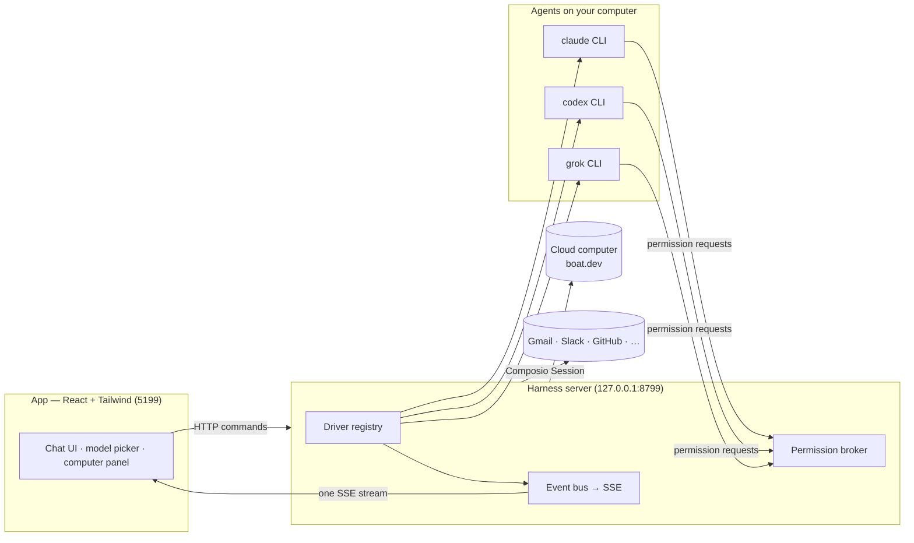

<div align="center">

# Uni

**Your own team of AI agents — in a chat app you host yourself.**

[Download](https://github.com/AdilShamim8/Uni/releases/latest) · [Docs](https://github.com/AdilShamim8/Uni/tree/main/docs) · [Contributing](CONTRIBUTING.md) · [Security](SECURITY.md)

Uni turns a team of local AI agents into contacts you message. Every bot in the
sidebar runs a real engine on your own machine — Claude, Codex or Grok — with its own
personality, its own model, its own computer and its own connected apps. You talk, it
works, you approve what matters.


[](https://github.com/AdilShamim8/Uni/releases/latest)


<br>

<a href="https://github.com/AdilShamim8/Uni/releases/latest/download/Uni.dmg">
  
</a>
&nbsp;
<a href="https://github.com/AdilShamim8/Uni/releases/latest/download/Uni-intel.dmg">
  
</a>
&nbsp;
<a href="https://github.com/AdilShamim8/Uni/releases/latest/download/Uni-setup.exe">
  
</a>
&nbsp;
<a href="https://github.com/AdilShamim8/Uni/releases/latest/download/Uni-amd64.deb">
  
</a>

<sub>[latest release](https://github.com/AdilShamim8/Uni/releases/latest) &nbsp;·&nbsp; macOS: Apple silicon & Intel · signed & notarized .dmg &nbsp;·&nbsp; Windows: x64 installer &nbsp;·&nbsp; Ubuntu 24.04 x64: .deb or AppImage beta &nbsp;·&nbsp; [all releases](https://github.com/AdilShamim8/Uni/releases)</sub>

</div>

---

> ⚠️ **No affiliation with any cryptocurrency.** Uni has no token. Any coin using the
> Uni name is not created, endorsed by, or affiliated with this project. I have received
> no tokens, payment, or allocation from anyone, and I will not be endorsing any token.

## The idea

One assistant in one box answers questions. A **team** gets work done — and teams need
more than a prompt box. Uni gives each agent a place in a messaging app: a name, a face,
a personality, its own model, its own Linux desktop, its own apps, and a memory of its
own threads. You manage them the way you manage people: group chats, channels, shared
instructions, and clear lines of approval.

Three commitments shape every design decision:

- **Bring your own agents.** Bots run on the `claude`, `codex` and `grok` CLIs already
  installed and logged in on your machine — no new accounts, no middleman proxy, no
  per-seat billing. Want a pinned or wrapped binary? Point any engine at it in
  **Settings → Engines**.
- **Local first.** One small harness server bound to `127.0.0.1` owns every agent
  process. Transcripts, events and keys live in `~/.uni` on your disk, not ours. What
  leaves your machine leaves it because you asked — a bot you sent to a cloud desktop,
  an app you connected, a phone you paired.
- **Agents with hands, on a leash.** Each bot can work on a cloud Linux desktop, an
  isolated Local VM, or — where the platform safety boundary is certified — your own
  computer, with 500+ apps through Composio. Host control is opt-in on macOS and
  Ubuntu Xorg; Ubuntu Wayland stays fail-closed until its safety gate is resolved.

## What's inside

**🧠 A model picker that behaves like a phone plan picker.** Claude and Codex models
side by side in one rail, defaults marked, unavailable providers dimmed with the reason
why. Switch any bot's model mid-conversation; the thread keeps its context.

**🖥️ A computer for every bot.** Open the Computer panel and the bot's cloud desktop
boots on its own — a live screen preview while it works, **Open desktop** to take over
in your browser, or assign the bot *this computer* instead. Cloud desktops come from
Boat; a Local VM keeps risky work off your machine entirely.

**🙋 Approvals, not surprises.** Shell commands, file edits and questions surface as
cards in the chat: allow, deny, or answer in place. The same permission broker guards
cloud, VM and local computers, so an agent never spends your trust silently.

**🔌 500+ apps, one OAuth.** A one-click marketplace over Composio Sessions: Gmail,
Slack, GitHub, Notion, Linear and hundreds more. Authorize once in settings; every bot
can use the connection as a tool — and you can revoke it from the same screen.

**#️⃣ Channels for every context.** Work, Personal, each project — separate channels
without cloning bots. Each channel has its own transcript, shared instructions, working
folder, responder rules and bot roster; file it under a named context and reshuffle the
team whenever it changes.

**⚡ Routing that thinks fast.** Give Jev a Cloudflare Workers AI token, a TypeSafe Jev
key, or an OpenRouter key and model in **Settings › AI › Routing and extraction**, and
rooms set to **Auto** pick the right bot for each un-mentioned message in a few hundred
milliseconds — falling back to the room's lead whenever the router is off or unsure.
([docs/decision-model.md](docs/decision-model.md))

**📦 Teams as one Markdown file.** A team package is a readable `.md` file with YAML
frontmatter: the bots, the Chief of Staff, channels, playbooks, a connector checklist
and suggested routines. Import from disk or paste a public GitHub URL under
**Teams → Import**; a review screen shows everything before anything is created.
Connections stay off until you approve them, routines arrive paused, and packages
never carry credentials, conversations, permissions, memory or computer access.

**🤝 Share a bot or a whole department.** Ask a bot to *publish itself to GitHub*, or
open a department's **…** menu → **Share**: one card carries the bots, instructions,
skills, group chats, routines and the apps they use — never chats, memory, keys or
addresses. Publish to the community repo for a link, or save a folder; anyone imports
it with **+ → Import…**. ([docs/team-sharing.md](docs/team-sharing.md), [docs/org-library.md](docs/org-library.md))

**🎧 Bots that talk back.** Press the speaker on a reply, or let a bot read its answers
as they land. Hit **call** and it's a conversation: it hears you, narrates its work,
and asks for approvals out loud. ElevenLabs, Fish Audio, Grok (xAI), built-in Mac
voices or a local Chatterbox server — one key per family, one voice per bot.
([docs/voice-mode.md](docs/voice-mode.md))

**Also in the box:** streaming replies with tool-run activity chips · dictation from the
composer mic (on-device Apple speech on macOS, Fish Audio speech-to-text on Windows and
Linux) · cursor mascots with role-aware expressions · the bot's own screenshots folded
into the transcript.

## How it works

Two processes, one contract. The app holds no transports of its own: it sends typed
commands over HTTP and folds a single SSE event stream into state. The harness server
owns every agent process and normalizes each provider's native protocol — stream-JSON,
JSON-RPC, ACP — into one canonical runtime event stream, logged per-thread as NDJSON.



| Layer | Where | What it does |
|---|---|---|
| Drivers | `server/drivers/` | One per provider: Claude, Codex and Grok Build over their local CLIs, plus a cloud-computer agent. An unknown driver degrades to "unavailable" — it never crashes the fleet. |
| Harness | `server/harness/` | The registry (configs → live instances) and the fan-in event bus every client folds. |
| API | `server/index.ts` | Bots, turns, approvals, model catalog, computer lifecycle, connectors, config — HTTP + SSE. |
| Voice | `server/tts/` | ElevenLabs, Fish Audio, Grok (xAI), built-in Mac voices or local Chatterbox. Cloud keys stay server-side; markdown is rewritten into something worth hearing before it is spoken. |
| App | `src/` | The chat shell: a server-backed store, one reducer, zero client-side transports. |
| Desktop | `electron/` | macOS, Windows and Ubuntu shells with an embedded harness and platform capabilities; Apple speech stays macOS-only, Ubuntu Xorg has opt-in local control, Wayland remains fail-closed. |

### Orchestrate Uni over MCP

The bundled stdio MCP server exposes a deliberately bounded control plane to external
clients like Claude Desktop or Cursor: inspect bots and channels, read and search
compact transcript pages, create and configure bots, channels and tasks, send work,
wait for completion, switch models, interrupt turns. It does **not** expose approval
grants, deletion, arbitrary settings, credentials or computer lifecycle. Setup and the
full tool reference: [docs/mcp-server.md](docs/mcp-server.md).

### Drive it from scripts and CI

The `uni` command drives a running workspace without a screen: apply a team from a
file, give a bot one job, wait until it and every teammate it drafted are done, export
what they made — one JSON document with `--json`, exit codes a pipeline can branch on.

```sh
uni team apply team.yaml
uni run "Room Lead" "Rehearse the launch of https://example.com" --export ./out
```

Reference: [Run Uni from scripts and CI](docs/headless-cli.md).

## Quick start

**Released builds ([latest release](https://github.com/AdilShamim8/Uni/releases/latest)):**
the harness server is embedded, so there is no separate server to set up.

| | Download | Install |
|---|---|---|
| **macOS** (Apple silicon) | [Uni.dmg](https://github.com/AdilShamim8/Uni/releases/latest/download/Uni.dmg) | Drag to Applications, open. Signed & notarized. |
| **macOS** (Intel) | [Uni-intel.dmg](https://github.com/AdilShamim8/Uni/releases/latest/download/Uni-intel.dmg) | Same app, built for Intel Macs. Signed & notarized. |
| **Windows** (x64) | [Uni-setup.exe](https://github.com/AdilShamim8/Uni/releases/latest/download/Uni-setup.exe) | One click, per-user, no admin rights. Not code-signed yet — SmartScreen says "unknown publisher": **More info → Run anyway**. |
| **Ubuntu 24.04** (x64) | [Uni-amd64.deb](https://github.com/AdilShamim8/Uni/releases/latest/download/Uni-amd64.deb) · [Uni.AppImage](https://github.com/AdilShamim8/Uni/releases/latest/download/Uni.AppImage) | Install the `.deb` with APT (recommended) or make the AppImage executable. Beta; GNOME is the supported desktop. |

The [Ubuntu Desktop guide](docs/linux-desktop.md) covers installation, capabilities and
troubleshooting. Any desktop build can also open the bots of another computer over
Tailscale — see [docs/desktop-companion.md](docs/desktop-companion.md).

**From source:**

```sh
git clone https://github.com/AdilShamim8/Uni && cd Uni
pnpm install

pnpm dev:server    # harness server → 127.0.0.1:8799
pnpm dev           # app → http://127.0.0.1:5199
pnpm dev:desktop   # Electron shell; keep the two commands above running
```

Requirements: **macOS, Windows or Ubuntu 24.04 x64**, **Node 24+**, **pnpm**, and at
least one agent CLI — [`claude`](https://claude.com/claude-code),
[`codex`](https://github.com/openai/codex) or [`grok`](https://x.ai/cli) — installed and
logged in. They appear in the model picker automatically.

Package the desktop application:

```sh
pnpm package:mac      # macOS: DMG + ZIP; requires Swift/Xcode tools
pnpm package:win      # Windows: installer + ZIP
pnpm package:linux    # Ubuntu x64: .deb + AppImage + verified CUA runtime
```

### Desktop capability status

| Capability | macOS | Windows x64 | Ubuntu 24.04 Xorg | Ubuntu 24.04 Wayland |
|---|---|---|---|---|
| Packaged app, embedded harness, local agent CLIs | Supported | Supported | Beta | Beta |
| Composio and Boat/cloud computers | Supported | Supported | Beta | Beta |
| Explicit preview-only local screen capture | Supported | Unavailable | Beta | Beta |
| Bot control of this computer | Supported | Supported | Beta, explicit opt-in | Disabled: Wayland safety gate (Omarchy with Cua's Hyprland plugin: experimental) |
| Native on-device dictation | Supported | Unavailable | Planned | Planned |
| Dictation and Take-turns calls through Fish Audio (needs a key) | Not used, on-device instead | Supported | Supported | Supported |

On Windows, choose **This computer** to let a bot control the local desktop: the
packaged app ships its own CUA driver and SDK, and local control works even though
preview-only capture does not. See [Computer use & browser use](docs/computer-use-integration.md).

The Linux preview is user-initiated and never enables local bot control or Auto
routing. On Xorg the reviewed Cua Driver 0.41.3 runtime starts only after explicit
opt-in and without its full-screen cursor overlay; on Wayland the app never starts it
and clears legacy opt-ins while the real-seat safety gate is unresolved. Chat, preview,
Cloud and Local VM remain available on both. The packager downloads only the
tag-pinned upstream archive during the build, verifies size, SHA-256, a complete member
allowlist and inner executable hashes, and ships Cua's MIT notice, Inter's SIL OFL, a
generated third-party license report and a CycloneDX inventory — see
[`third_party/cua-driver/`](third_party/cua-driver/) for the reviewed provenance record.

## Development

```sh
pnpm typecheck      # app + server
pnpm test           # unit, driver, API, and desktop capability tests
pnpm build          # typecheck + production build
pnpm check:electron # syntax-check Electron main/preload files
```

The driver SPI in [`server/contracts.ts`](server/contracts.ts) is deliberately small —
adding a provider is one file in [`server/drivers/`](server/drivers/) plus a one-line
registration. No code at all for your own engines: any ACP-speaking CLI or
OpenAI-compatible endpoint plugs in through config
([`docs/custom-engines.md`](docs/custom-engines.md)), and your own MCP tool servers need
zero code ([`docs/custom-mcp-servers.md`](docs/custom-mcp-servers.md)). Configuration
switches and defaults: [Feature switches](docs/feature-flags.md). Other providers —
OpenRouter, Fireworks AI, DeepSeek, Cline, any OpenAI- or Anthropic-compatible
endpoint: [Other model providers](apps/docs/content/docs/providers/model-providers.mdx).

## Triggers: schedules and webhooks

A trigger is "when something happens, a bot does something". Tell a bot *every weekday
at 9, send me a summary of my inbox* or *whenever our form is called, draft a reply*
and it sets the trigger up in that turn with its `trigger` tool — no confirmation
dialog, just a live card in the chat with Edit, Pause and Undo. The **Triggers** page
lists every schedule and webhook with a calendar and run history.

Schedules run once, on chosen weekdays, or every 5–1,440 minutes, using the bot's own
model and computer or the Cloud VM runner. Interval schedules stay aligned to their
start time and skip an occurrence while the previous run is still active, so slow work
never builds an unbounded queue; an optional advanced run limit stops stuck work only
if you set one.

**App events** start a bot when something happens in a connected app — an email from
Acme, a mention on Slack. The bot finds its app's events with `trigger_info` and
creates the trigger itself, or you choose **New → Set it up yourself → When something
happens in an app**. Composio delivers events to Uni's connected-apps service, the app
collects them with a long poll — so a closed desktop misses nothing and needs no public
address. Gmail polls every 15 minutes; Slack, GitHub and other push apps arrive at
once. Desktops keep 500 events a day, a paid Cloud 2,000; what is skipped shows on the
automation. Details: [docs/composio.md](docs/composio.md#app-events).

The webhook receiver listens on `127.0.0.1:8800` by default (or one port above
`OMB_PORT`; override with `OMB_WEBHOOK_PORT`), exposes only `/health` and secret
`/hooks/...` endpoints, and shows its secret once at creation or rotation. Bearer
authentication is recommended so the secret stays out of request URLs; a single
capability URL remains for senders that cannot set headers. Uni must be running to
accept a delivery — for public delivery, proxy only this receiver through a hosted
relay or Tailscale Funnel.

## Status

Early but real — the loop works end to end: message → agent → streamed reply → tools →
approvals → computer use. macOS, Windows and Ubuntu 24.04 x64 have released builds;
Ubuntu remains beta with the limits above. Hosted/mobile connectivity is still being
built, and webhook triggers use the local receiver rather than an always-on hosted
relay. Hosted voice needs an ElevenLabs, Fish Audio or xAI key; built-in Mac and local
Chatterbox voices need no cloud key. Take-turns calls and the composer mic listen
on-device on macOS and through Fish Audio speech-to-text on Windows and Linux.

## Privacy

Usage analytics are optional and anonymous: product events and a once-a-day count of
what is set up — never keys, names, addresses or conversations. Turn them off in
Settings → General → Usage analytics; [`docs/analytics.md`](docs/analytics.md) lists
every event and property.

## Support the project

Uni is free and open source. If it does real work for you,
[support its development through GitHub Sponsors](https://github.com/sponsors/AdilShamim8)
with a one-time contribution or a monthly sponsorship. Your support funds ongoing
development and maintenance; Uni stays free and open source either way.

## Run from a terminal or on a server

With Node 24 or newer:

```sh
npm install -g uni
uni
```

Or `npx uni` without a global install. First launch walks you through AI access, a
model and an optional phone with arrow-key choices; the next run reuses the saved setup
and opens Uni again. Keep the terminal open — Ctrl-C stops the server, not your saved
work. `--no-open` skips the browser, `--local` ignores saved remote access for one
launch, `--no-pair` suppresses phone prompts without disabling a saved remote
connection. `uni setup` reconfigures without resetting bots or conversations.

Be honest with yourself about keys: `uni setup` and the server store API keys as
plaintext in a private `config.json` (`0600` on Unix); the packaged desktop app keeps
AI provider and service keys encrypted through the operating system instead, while its
`config.json` still holds OpenCode provider keys, per-engine keys and MCP header values
in plaintext (a key a bot set from a secret card lives in the Vault; `config.json`
keeps only a pointer). The [short setup guide](docs/cli-onboarding.md) covers account
differences, phone choices, credential storage and cancellation.

For an always-on server, `npx uni serve` takes one way in: `--public-url` behind your
own cloudflared, Caddy or nginx, `--domain` for a certificate on your own domain,
`--tailscale` for your tailnet, `--lan` for this network only, or `--tunnel` (after
`npx uni account login`) for a free hosted web address. It prints one pairing link —
paste it into the desktop app under **＋ → Connect to a server**. Each install path's
short version sits at the top of [docs/self-hosting.md](docs/self-hosting.md); a server
from scratch is [docs/deploy-vps.md](docs/deploy-vps.md).

## License

[Apache License 2.0](LICENSE) © 2026 Adil Shamim and Uni contributors, except
`enterprise/`, which is source-available under its [own license](enterprise/LICENSE);
delete that folder and what remains is the open-source edition — details in
[LICENSING.md](LICENSING.md). Packaged Cua Driver components retain their upstream MIT,
SIL OFL 1.1, MPL-2.0 and other dependency terms; notices, sources and the SBOM are in
[`third_party/cua-driver/`](third_party/cua-driver/) and ship beside the runtime.

<div align="center">

<sub>Built with patience by [Adil Shamim](https://github.com/AdilShamim8) and contributors.</sub>

</div>
